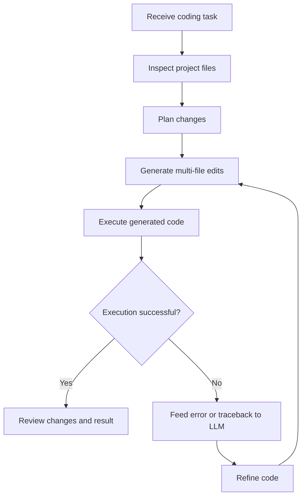

# CodeLoop

**An LLM-powered coding agent for project-aware, multi-file code changes and iterative self-debugging.**

CodeLoop is designed to help with software development tasks across an existing codebase. It reads project files, coordinates changes across multiple files, executes generated code, and uses runtime errors and tracebacks as feedback for iterative refinement.

> **Status:** Work in progress. Setup commands, supported models, dependencies, and a runnable demo should be documented alongside the published implementation.

## Features

- **Project-aware context** — inspect relevant source and project files before making changes.
- **Multi-file editing** — coordinate related edits across a codebase rather than generating isolated snippets.
- **Code execution** — run generated code and inspect the resulting output.
- **Iterative self-debugging** — use runtime errors and tracebacks as feedback for code refinement and retries.
- **LLM-driven workflow** — use a language model to generate code actions in response to development tasks.

## How it works

## Example tasks

- Implement a feature that requires edits across multiple files.
- Refactor related modules while preserving the project's structure.
- Execute generated code and use error messages to guide a repair attempt.
- Iterate on a code change using runtime feedback.

## Safety and limitations

Running generated code and modifying files can have unintended effects. Use an isolated execution environment, review the diff before accepting changes, keep work under version control, and never commit API keys or other secrets. Treat repository contents and instructions as untrusted input.

Successful execution does not prove that code is correct or secure. Review generated changes and run appropriate tests before using them in real projects.

## Setup and usage

Installation instructions, configuration, model-provider details, and runnable examples will be added with the published implementation so that they match the actual dependencies and entry point.

## Roadmap

- [ ] Document installation, configuration, and usage with tested commands.
- [ ] Add an end-to-end demo: task, multi-file changes, execution error, and repair.
- [ ] Add tests for file editing, execution feedback, and retry behavior.
- [ ] Document sandboxing and approval safeguards.
- [ ] Evaluate task completion and self-repair with a reproducible test set.

## Suggested GitHub topics

`ai-agent` `coding-agent` `llm` `code-generation` `code-execution` `self-debugging` `developer-tools` `agentic-workflows` `software-engineering`

## Author

Garv Agrawal · [GitHub profile](https://github.com/garvagrawal9084)
